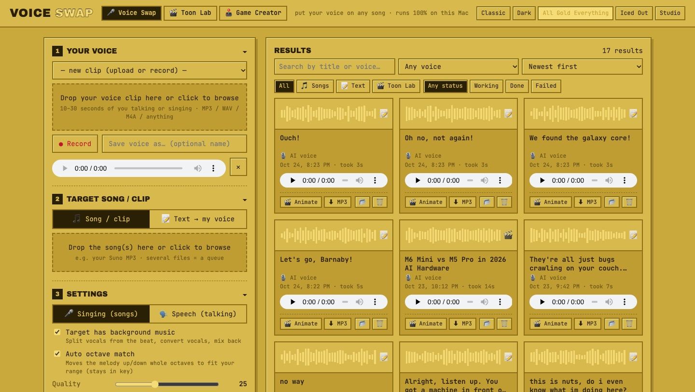
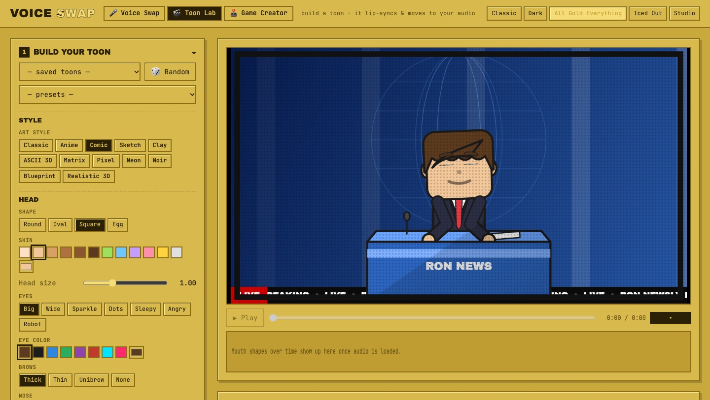
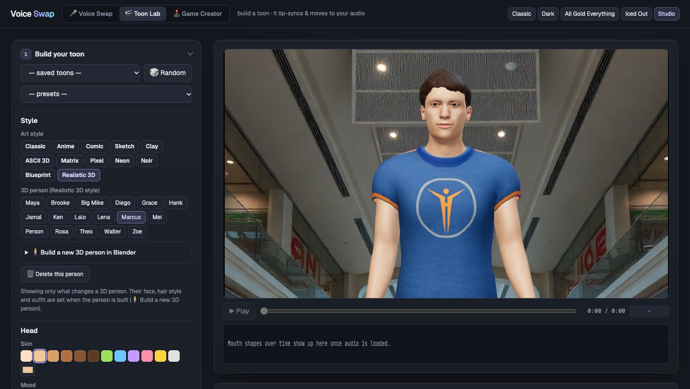
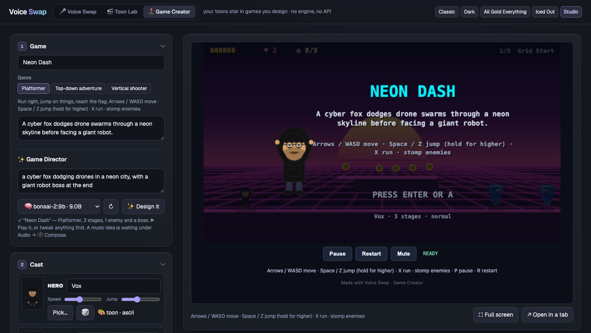
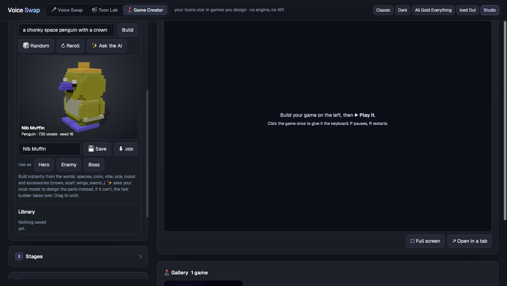
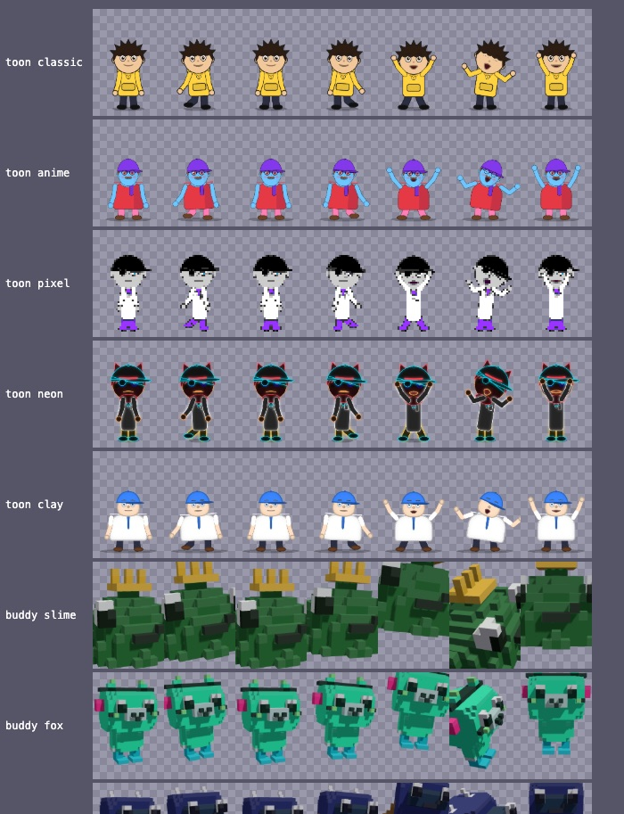
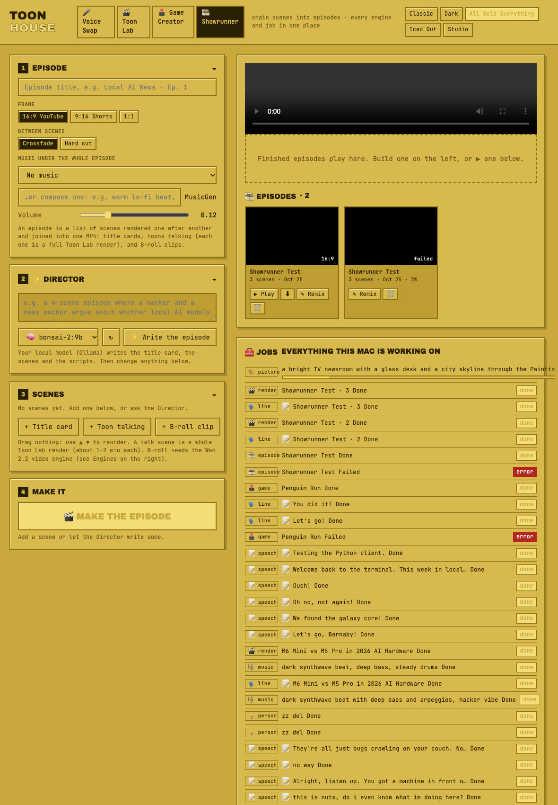
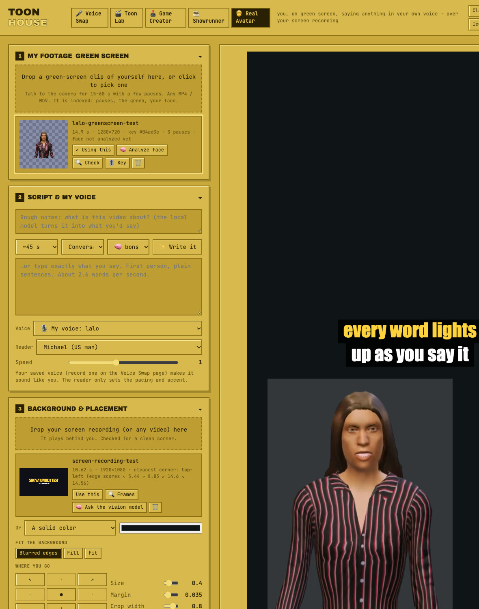

# Toon House

Five rooms, one local app: **Voice Swap** puts your own voice on any song, **Toon Lab** makes cartoons and 3D people that lip-sync in it, the **Game Creator** turns them into playable games, the **Showrunner** cuts talk scenes, title cards and B-roll into whole episodes, and **Real Avatar** puts you, filmed once on a green screen, over your screen recording, saying anything in your own voice. Free, offline, no training, no API keys.

Put **your own voice** on any song — locally, free, no training.

Give it 10–30 seconds of you talking (or singing) and a target track (e.g. a Suno MP3). It splits the vocals from the beat, re-sings the vocals in your voice, and mixes them back into a new MP3.

Everything is one file: **`index.php`**. The first time you open it, it installs its own engine next to itself.



| Piece | What it does |
|---|---|
| [Demucs](https://github.com/facebookresearch/demucs) (htdemucs) | Splits the song into vocals + instrumental |
| [Seed-VC](https://github.com/Plachtaa/seed-vc) (44 kHz singing model) | Zero-shot voice conversion — your timbre, the original melody & lyrics |
| [Kokoro](https://huggingface.co/hexgrad/Kokoro-82M) (82M TTS) | Reads text out loud, so you can type what your voice says |
| ffmpeg | Decoding, cleanup, final mix → 320 kbps MP3 |
| [Z-Image Turbo](https://huggingface.co/mflux-community/z-image-turbo-mflux-q8) through [mflux](https://github.com/filipstrand/mflux) (optional) | Paints scene pictures on this Mac, no account |
| [Wan 2.2 TI2V-5B](https://huggingface.co/Wan-AI/Wan2.2-TI2V-5B) through mlx-video (optional) | Turns a prompt or a scene picture into a short video clip |
| Phonon and other speech models in [Ollama](https://ollama.com) (optional) | More reader voices, in more languages |
| [MuseTalk 1.5](https://github.com/TMElyralab/MuseTalk) through the [musetalk-mac](https://github.com/barnent1/musetalk-mac) port (optional) | Redraws your mouth in your own green-screen footage to match the words (Real Avatar) |
| [MediaPipe](https://ai.google.dev/edge/mediapipe) Face Landmarker (vendored, runs in the browser) | Camera motion capture in Toon Lab; finds your talking stretches, pauses and face in Real Avatar footage |
| [Pillow](https://python-pillow.org) | Draws title cards, and the subtitles and captions burned into Real Avatar videos |

## Requirements

- Mac with Apple Silicon (M1/M2/M3/M4). **16 GB+ RAM recommended, 32 GB ideal.** 8 GB works for short clips with everything else closed.
  Linux works too (CPU or NVIDIA).
- ~6 GB free disk (Python packages + ~2 GB of models). The optional local painter adds ~7 GB, local video ~9 GB (32 GB more while it installs) and lip-sync for Real Avatar ~6 GB; see *Local painter & video* and *Real Avatar* below.
- Homebrew packages:

```bash
brew install php ffmpeg python@3.11 git
```

## Install & run

One line does it all (installs the tools above, clones the app, installs the engine, offers Ollama):

```bash
curl -fsSL https://raw.githubusercontent.com/lalomorales22/toon-house/main/install.sh | bash
```

It asks before anything big, never uses sudo on macOS, and ends by starting the app. Flags: `--yes` (no questions), `--no-engine` (skip the ~3 GB engine download), `--ollama` (also set up a local model), `--dir <path>`. Already cloned? `./install.sh` works from inside the folder too.

By hand:

```bash
git clone https://github.com/lalomorales22/toon-house.git
cd toon-house
php index.php
```

That starts a local server at **http://127.0.0.1:8777** and opens your browser. Click **Install engine** (one time, ~10 min: downloads PyTorch, Seed-VC, Demucs and the models into `engine/`).

Prefer the terminal for the install? `php index.php setup`

> Always start it with `php index.php` (not `php -S …` by hand) — the launcher raises PHP's upload limit to 1 GB so full songs upload.

## Use it

1. **Your voice** — drop a clip, hit **● Record** (up to 40 s), or pick a saved voice. Type a name in *Save voice as…* to reuse it later.
2. **Target song** — drop one or more MP3/WAV/M4A/FLAC/MP4 files. Several files = a queue.
   Or switch to **📝 Text → my voice**: type, paste, or drop a `.txt` / `.md` file. An AI reader (pick one close to your accent and pace) speaks it, then it's converted into your voice. Markdown headings, bullets and links are cleaned up first.
   The **Reader** list has Kokoro's 17 voices plus any speech model you've pulled into Ollama, under *Ollama · model*: `ollama pull phonon` adds about 40 named voices, and `phonon:40m-multilingual` adds Spanish, French, Portuguese and German ones. They speak through Ollama's `/v1/audio/speech`; the speed slider is applied with ffmpeg, and word timings for subtitles come from Whisper afterwards (Kokoro has exact timings).
3. **Settings**
   - **Singing / Speech** — Singing for songs (keeps the melody). Speech for spoken clips.
   - **Target has background music** — on for songs, off for a dry acapella or voice clip.
   - **Auto octave match** — if the original singer is in a different range than you, it moves the melody whole octaves only, so you stay in key with the beat.
   - **Quality** — diffusion steps. 25 is a good default; 40–50 for final renders.
   - **Pitch** — manual semitone shift on top of auto.
   - *Advanced*: clean my voice clip, voice likeness, vocal/music volume, and *Original vox* (blend some of the original singer back in — helps harmonies/ad-libs).
4. **Generate.** When it's done you get:
   - **Song with my voice** (the full mix)
   - **My vocals only**
   - **Instrumental**

Every result lands in the **Results** gallery: search by title or voice, filter by kind (songs, speech, text, Toon Lab) and status, and sort. Files are saved in `jobs/<id>/`; 📂 opens the folder in Finder.

The steps fold up (click a heading) and stay the way you left them. Pick a look in the top right: Classic, Dark, All Gold Everything, Iced Out or **Studio** (graphite and lavender, for long sessions).

## Live Studio — cameras, OBS and your avatar, live

Click **📡 Live Studio** in the header. This room runs [video-stream](https://github.com/lalomorales22/video-stream), the live side of the house: every camera with an OBS-ready link, phones and tablets as cameras, an auto-director that switches OBS scenes for you, a face-tracked avatar, and **Moves** (record a performance once, replay it on any avatar).

- **▶ Start Live Studio** starts it and shows it right here; **■ Stop** shuts it down. It turns your cameras on, so it never starts by itself.
- **Let devices on my Wi-Fi connect** is off by default, so it only answers this computer. Turn it on before starting if you want phones or tablets to join over Wi-Fi or OBS on another machine to pull the feeds. While it is on, anyone on your Wi-Fi can open the cameras; set an admin password under Setup in Live Studio.
- **Open in its own tab ↗** gives it a full window (handy on a second monitor).

It is a separate app with its own engine (Python; it holds live video and WebSocket connections open, which this app's PHP server is not built for), so install it once:

```bash
git clone https://github.com/lalomorales22/video-stream.git && cd video-stream && ./install.sh --all
```

Toon House finds its `video-stream` launcher by itself, picks a free port (8770 and up), and only ever stops the copy it started. Its log is `live.log` next to `index.php`.

## Toon Lab — make a cartoon lip-sync to audio



Click **🎬 Toon Lab** in the header (or **🎬 Animate** on any finished Voice Swap result).

1. **Build your toon**:
   - **Art style**: Classic, Anime, Comic, Sketch, Clay, ASCII 3D, Matrix, Pixel, Neon, Noir, Blueprint or **Realistic 3D**. 🎲 rolls the style too.
   - **Realistic 3D** swaps the cartoon for a rigged 3D person rendered with [Three.js](https://threejs.org): real skin and hair, soft shadows, lip-sync from the same mouth shapes (Oculus visemes), blinking, eye darts, head nods and hand gestures. Pick the **3D person**. Hair, clothes and skin colors, glasses/shades, background, camera, subtitles and captions all still apply; props, hats and the cartoon face options don't.
     
     - Two ready-made people download on first use (~40 MB): Maya (MakeHuman, CC0) and Brooke (Ready Player Me, CC BY-NC: personal use).
     - **🧍 Build a new 3D person in Blender**: body, age, build (slim, average, athletic, heavy), height, ethnicity (face shape), skin tone (light to dark), hair and hair color, brows, eye color, outfit and shoes. It runs Blender in the background with the free [MPFB](https://static.makehumancommunity.org/mpfb.html) (MakeHuman) extension and the [TalkingHead](https://github.com/met4citizen/TalkingHead) rig and face shapes, and takes about 10 seconds. The first build installs MPFB into Blender and downloads ~280 MB of CC0 skins, hair and clothes. Presets are played by Marcus, Walter, Theo, Ken and Rosa when those exist.
     - **Photo likeness**: add a front photo of a real face and it is painted onto the person's skin (beard, mouth, nose, forehead), lined up with [MediaPipe](https://developers.google.com/mediapipe) on your Mac. **Glasses → Black frames** builds 3D frames to fit the face, and **Outfit color** recolors the clothes. It is a likeness on a MakeHuman head, not a scan. From the command line: `"photo": "/path/front.jpg"`, `"glasses": "frames"`, `"outfitColor": "#16161a"` and `"replace": true` in `person.json`. Needs [uv](https://docs.astral.sh/uv/); use your own face or one you have permission for.
     - Any GLB with a Mixamo-style skeleton and ARKit + Oculus viseme blend shapes works: drop it in `avatars/`. An optional `avatars/<name>.json` sets `label`, `mouth` (lip-sync strength) and `tongue`.
   - **Look**: head, skin, eyes (including sparkle, angry and robot), brows, nose, ears, mood, 13 hair styles, hats (cap, beanie, hood up, top hat, cowboy, crown, wizard), face fuzz, build and outfit (tee, hoodie, jacket, suit, jersey, lab coat, overalls, robe, dress).
   - **Accessories**: glasses, shades, cyber visor, eye patch, chain, tie, bow tie, scarf, headphones and more.
   - **Something to hold or sit at**: mic, coffee, phone, guitar, gamepad, computer desk, laptop or news desk.
   - **Background**: stage, sky, studio, hacker den, city night, newsroom, matrix rain, space, synthwave, solid color, green screen, or **🖼 Picture**: a scene of your own.
     - Describe a scene and **🎨 Make it**, in a look that matches the art style. With the local painter installed (see [Local painter & video](#local-painter--video-optional-extras)) the provider dropdown defaults to **On this Mac: Z-Image Turbo**: no network, no account, about 1.5–2 minutes, painted in the background with a progress bar. The other providers are [FLUX.1-schnell](https://huggingface.co/black-forest-labs/FLUX.1-schnell) through your Hugging Face login (`hf auth login`, the free monthly credits cover a few dozen pictures) and *Free, no account* (Pollinations: lower quality, small watermark).
     - **⬆ Upload** (or drop) any JPG / PNG / WebP, e.g. one made in ChatGPT. Pictures are kept in `scenes/` and the camera drifts slowly across them.
     - **🎞 Animate the selected picture** (needs the local video extra) turns the still into a 2–5 s Wan 2.2 clip that loops behind the toon while it talks. It takes several minutes. Clips are kept in `clips/`.

   Start from a **⭐ preset** (hacker, news anchor, rapper, anime, wizard, streamer, robot, cowboy, scientist), or 🎲 for a random toon. Name it and **Save** to reuse it. Saved toons can also star in the Game Creator.
   - **✨ AI Director** (step 2 → ✨ Director): describe a video in one sentence ("a hacker on a computer in 3D ASCII style talking about local AI news"). Your local AI model picks a preset, art style, captions and reader voice and writes the script. **📰 Find a news story on this** searches DuckDuckGo News for this week's stories on your topic. Pick one, and the script reports it from the article's own text, naming the source. It uses **Ollama** by default, and the dropdown lists every text model you've pulled. Under ⚙ Model server you can point it at any OpenAI-compatible server instead (llama.cpp, LM Studio, MLX…).
2. **Audio**:
   - **🎵 Audio**: drop a voice clip or song, pick a Voice Swap result, or hit **🎙 Live mic** to puppet the toon in real time.
   - **📝 Type it**: type a script, or load a `.txt` / `.md` file, and hit **🗣 Speak it**. It's read in your saved voice, or the AI voice only, which is faster. The Reader list is the same as Voice Swap's (Kokoro plus Ollama speech models). The mouth then syncs automatically, and subtitles use your exact words.
   - **⚡ Instant** runs as soon as the audio loads: it reads the vowel (ooo / ahh / eee…) from the sound's formants, right in the browser.
   - **🔬 Precise** (*Sync the mouth*) runs a phoneme recognizer ([wav2vec2 espeak](https://huggingface.co/facebook/wav2vec2-lv-60-espeak-cv-ft), ~1.2 GB, downloaded on first use) to find each speech sound, and Whisper for the words. Tick *Has background music* to isolate the voice with Demucs first. Voice Swap results use their clean vocals automatically.
   - **🎵 Background music**: pick a track, set its volume, and it loops under the voice, dipping while the toon talks, and fades out at the end. It's mixed into the recorded video. **🎼 Compose** writes a new track from a description with [MusicGen small](https://huggingface.co/facebook/musicgen-small) on this Mac (about a minute for 20 s; the first use downloads 2.4 GB; the model's license is non-commercial). Or upload your own MP3 / WAV. Tracks are kept in `music/`.
3. **Motion**:
   - **🎥 Move with my camera**: click 📷 Start camera and the character mirrors you live. [MediaPipe](https://ai.google.dev/edge/mediapipe) tracks your head (turn, nod, tilt), eyes and winks, brows, mouth, shoulders, both arms down to the hands, side-to-side steps, and your legs when they're in view. Realistic 3D people copy all 52 of your face shapes. Choose what it follows (face, arms, body), whether the mouth copies yours or lip-syncs to the audio, and how much smoothing. It all runs in the browser, and no video leaves the Mac.
     - **● Record video** with the camera on records you acting it out: over the loaded clip, with 🎙 Live mic, or silently.
     - **● Record my moves** captures just the performance (acting along to the clip if one is loaded). With the camera off, your moves then play back on any audio, e.g. a script you type and 🗣 Speak it. Takes last until you reload the page.
   - **Automatic motion**: mouth size, body energy, hand gestures, sync offset, *Dance to the beat*, and the **camera** framing (full body, medium, close-up).
4. **Subtitles & captions** (burned into the video):
   - *Subtitles* come from the Whisper words: Karaoke (word highlight), Classic subtitle, or Pop words, in 12 fonts, with size, colors, position and an optional dark box. Fix misheard lines under *Fix the subtitle text*, and download them as an `.srt` for YouTube.
   - *Captions* are your own text: titles, lower-thirds and speech bubbles, each with its own font, color, size and start/end time.
5. **Make the video** (bottom of the sidebar): pick the frame (16:9, 9:16, 1:1) and **● Record video**. It plays the clip, records the stage + audio and saves an MP4 in `renders/`.
   Every MP4 lands in the **🎞 Gallery** under the stage: search it, filter by frame and style, sort it, and click a video to play, download, show in Finder or delete it.
   Or **🚀 Make it in the background**: it speaks the script, syncs the mouth and records in a hidden Chrome window while you keep working. This needs Google Chrome, Chromium, Brave or Edge.

## Game Creator — your toons star in games you design



Click **🕹 Game Creator** in the header. Games run on a small engine built into the app: no game framework, no API, nothing to install. Every game is **one HTML file** with its sprites, backdrops, music and voice lines embedded, so it plays anywhere, offline.

1. **Game**: a name, a genre, a line for the title screen.
   - **Platformer**: run right, jump on things (hold for higher), stomp enemies, springs, keys and locked doors, reach the flag.
   - **Top-down adventure**: rooms and corridors, 8-way movement, a sword swing (Space), a dash (X), key and door, an exit.
   - **Vertical shooter**: fly up, hold Space to fire, X drops a bomb; waves of enemies, asteroids, mines and a boss.
   - **✨ Game Director**: describe the game in a sentence and your local model (Ollama) picks the genre, invents the cast as voxel buddies, lays out the stages and writes the voice lines. Then change anything.
2. **Cast**: a hero, up to three enemies (each patrols, chases, flies or shoots) and an optional boss. Pick any toon saved in Toon Lab or a preset (they keep their art style in the game: anime, pixel, neon, clay…), a random toon, or a **voxel buddy**. Every character is rendered into a 7-frame sprite sheet: idle, walk, jump, hurt, win.
   - **🧱 Voxel buddies**: type a sentence ("a chonky space penguin with a crown") and a chunky 3D character is built instantly from the words: species, color, vibe, size, mood and accessories.

     
 ↻ Reroll for another take, **✨ Ask the AI** to have your local model design the parts, 💾 Save to the library, ⬇ export a `.vox` for MagicaVoxel, Goxel or Blender. Adapted from [voxel-buddies](https://github.com/lalomorales22/voxel-buddies), with Ollama instead of a paid API.
3. **Stages**: up to 8. Each has a backdrop (any Toon Lab background, or a scene picture), a length, a challenge level, an optional key and door, an optional boss, and its own music track. **🎲 New layout** generates the level from a seed; then **paint** it: ground, platforms, coins, gems, spikes, springs, keys, doors, enemies, the boss, the start and the goal. Right-click erases.
4. **Rules & feel**: lives, difficulty, how a stage is cleared (reach the goal, collect every coin, beat the boss, survive the clock), a time limit, gravity, jump and speed, and the win / game-over lines.
5. **Audio**: sound effects are synthesized in the game (four styles: chip, arcade, soft, glitch; 🎲 gives any effect a different take). Music is any track in the `music/` library, and you can compose one with MusicGen right there. Voice lines are spoken in your saved voice (or the AI reader) at the start, on a win, on game over and when hurt.
6. **Play & save**: **▶ Play it** runs the game in the page (keyboard and touch), **💾 Save** keeps it in the gallery, **⬇ Download** gives you the HTML file. Any saved game can be played, remixed or downloaded from the gallery.

In a game: arrows / WASD move, Space or Z is the action, X the second action, Enter starts, P pauses, R restarts. Progress is checkpointed at each stage in the browser.



The cartridge format and the cast / stages / rules model follow the Game-Maker app; the engine, level generators, sprite pipeline and sound synth are built into `index.php`.

Games can also be built without the page: `POST ?a=game_make` (or `php index.php game spec.json --wait`, or `game --prompt "…" --wait`) speaks the voice lines, opens the Game Creator in a hidden Chrome window to draw the sprites, and writes `games/<id>/`. A 2-stage platformer with two voice lines took 8 s. The spec shape is in the skill, below.

## Showrunner — episodes from scenes



Click **🎞 Showrunner** in the header. An episode is a list of scenes, rendered in order and joined into one MP4 with crossfades (or cuts):

- **Title card**: big text and a subtitle on a colored card (drawn with Pillow).
- **Toon talk**: a full Toon Lab render: a preset or saved toon, art style, script, scene picture, your voice or a reader voice, camera, subtitles, and an automatic lower-third with the character's name.
- **B-roll**: a short Wan 2.2 clip from a prompt or a scene picture (needs the local video extra, below).

Episode-wide **music** (pick a track or compose one with MusicGen) runs under everything, ducked by volume, and fades out at the end. **✨ Director**: one sentence ("a three-scene episode where a hacker and a news anchor argue about local AI") and your local model writes the whole episode as structured output through Ollama: title, scenes, scripts. Then edit anything before you render. Finished episodes land in `renders/`, so they show up in Toon Lab's gallery too, and in `shows/<id>/` with each scene's own MP4. Measured: a title card plus two talk scenes rendered in 85 s and came out as 10.6 s of 1920x1080 video.

The page has three more panels:

- **🧰 Jobs**: every queue on the Mac in one list: songs, speech, voice lines, renders, music, pictures, clips, people, games, episodes, Real Avatar videos and footage indexing.
- **⚙ Engines**: what's installed (engine, renderer, painter, video, lip-sync, Ollama text and speech models, free disk), with one-click installs for the local painter, video and lip-sync.
- **🐍 Recipes**: the Python scripts in `recipes/`, listed by their docstring. Run one with arguments from the page and watch its log.

## Real Avatar — you, over your screen recording



Click **🧑 Real Avatar** in the header. Film yourself once against a green (or blue) screen, and from then on the app can put you over any screen recording, saying whatever you type, in your own cloned voice. With the lip-sync engine installed (below) your mouth follows the words.

1. **My footage** — drop a green-screen clip of yourself (MP4 / MOV; from a script, `footage_upload`). It is indexed on upload: the pauses (ffmpeg `silencedetect`), the screen color (sampled from the frame edges), a keyed preview (VP9 with alpha) and contact sheets to check it: `silent-windows.jpg` (the middle of each pause), `p0-frames.jpg` (12 frames around the best neutral moment) and `talk-frames.jpg`. **🧠 Analyze face** runs MediaPipe's Face Landmarker over the clip in the browser (vendored, offline): the jawOpen and eyeBlink blendshapes give the talking stretches, the idle windows, neutral eyes-open, mouth-closed frames and the face box. They are saved into the index and the sheets are redrawn. **🎚 Key** has the chroma-key sliders: a *Similarity* of 0.08–0.15 is right (higher starts eating the person); **↻ Re-key the preview** shows the result.
2. **Script & my voice** — jot down what the video is about and hit **✨ Write it**: the local model turns the notes into a plain-text script for the length you picked (about 2.6 words per second). Or type exactly what you say. It is spoken in your saved voice (the first saved voice by default) through the same Kokoro → Seed-VC pipeline as Voice Swap, and the word timings drive the subtitles.
3. **Background & placement** — drop a screen recording (`broll_upload`). It is checked for the cleanest corner (an edge-energy score per corner, and a recommendation), and **🧠 Ask the vision model** shows its frames sheet to any vision model you have in Ollama (e.g. `minicpm-v`) when you want a second opinion. Or pick a scene picture, a Wan clip, or a solid color. *Fit the background*: blurred edges (default), fill or fit. Then where you go: a corner (bottom-left by default), your size (a fraction of the frame height, 0.4 for 9:16), the margin, the crop width (a portrait crop around your face), mirror, and a round bubble.
4. **Subtitles & captions** — karaoke, classic or pop-word subtitles, drawn with Pillow in a system font (Impact, Arial Black, Helvetica, Avenir Next Condensed, Futura, Phosphate, Chalkboard, Comic Sans MS, Trebuchet MS, Verdana, Copperplate, Luminari) with colors, size, position and a dark box. Captions are your own text: a title, and lower-thirds that go on the side away from you, each with a start and end time.
5. **Make it** — pick the frame (9:16, 16:9, 1:1) and **🎬 Make my video**. The worker speaks the script, chains the talking stretches of your footage with crossfades until they cover the voice, lip-syncs them with **MuseTalk 1.5** (it redraws the mouth to the words, on the GPU) when the engine is installed, otherwise uses the footage as-is and says so in a warning, keys out the green with ffmpeg's chromakey plus despill, places you over the fitted background, burns in the subtitles and captions, and mixes the sound: your voice, the recording's own sound at low volume, and music if you add some. The MP4 lands in `renders/` (so it is in Toon Lab's gallery too), and `reals/<id>/` keeps `synced.mp4`, two diagnostic sheets (`avatar-frames.jpg`, `composite-frames.jpg`) and, if you tick *Also export the keyed avatar alone*, `avatar.webm`: you by yourself, keyed, with transparency, for other editors.

**Lip-sync install**: Showrunner → ⚙ Engines → **Install lip-sync**, or `php index.php extras install lipsync`. It fetches the [musetalk-mac](https://github.com/barnent1/musetalk-mac) port of MuseTalk (MIT, pinned to one commit), makes a Python 3.11 venv with PyTorch, MediaPipe and diffusers (~2 GB of packages), and downloads ~4 GB of weights from Hugging Face (the MuseTalk 1.5 UNet, the SD VAE, Whisper-tiny and a face parser). Until it is installed, videos still render, with your mouth moving as it did in the footage. Measured on an M4 Mac mini: a 15 s video without lip-sync renders in about 95 s; with MuseTalk, add its own time (not measured yet).

**What to film**: an even light on the screen and on you, no shadows across the green, and a step of distance between you and it. Talk to the camera for 15–60 s and leave a few pauses with your mouth closed, so the index can tell your talking stretches from the idle ones and find a neutral frame. Any camera is fine, and so is mono sound: the footage's audio is only used to find the pauses. Footage lives in `footage/` (with its index, preview and sheets), screen recordings in `broll/`, finished videos in `reals/<id>/`.

From a script: `php index.php real spec.json --wait`, `ToonHouse().real({...})` from Python, or `python3 recipes/real_avatar.py --notes "…" --broll ~/Desktop/demo.mov --title "…"`. The spec is in the skill, below.

## Local painter & video (optional extras)

Both are optional, run on Apple Silicon only, and install from **Showrunner → ⚙ Engines**, next to the lip-sync engine for Real Avatar (above). Nothing leaves the Mac and no account is needed. `php index.php extras` prints what's installed; `php index.php extras install painter|video|lipsync` installs one from the terminal.

**Painter: Z-Image Turbo through [mflux](https://github.com/filipstrand/mflux)** (MLX). *Install the painter* installs [uv](https://docs.astral.sh/uv/) if it's missing, runs `uv tool install mflux`, and downloads the pre-quantized [`mflux-community/z-image-turbo-mflux-q8`](https://huggingface.co/mflux-community/z-image-turbo-mflux-q8) (~7 GB) into `engine/models/z-image-turbo-q8`. From then on the scene panel offers **On this Mac: Z-Image Turbo** and uses it by default. The app paints 1024x576 at 8 steps, about 1.5–2 minutes. Measured on an M4 Mac mini with 32 GB: 1280x720 in ~156 s, 7.4 GB peak memory.

**Video: Wan 2.2 TI2V-5B through mlx-video**. *Install video* makes `engine/venv-video` (uv, Python 3.12, `mlx-video-with-audio` plus torch for the conversion), downloads [Wan-AI/Wan2.2-TI2V-5B](https://huggingface.co/Wan-AI/Wan2.2-TI2V-5B) (32 GB) unless you paste the path of a folder you already have (kept in `settings.json` as `wan_checkpoint`), converts it to MLX 8-bit (~9 GB) in `engine/models/wan22-ti2v-5b-mlx`, and deletes the download. Then you can:

- Toon Lab → scene panel → **🎞 Animate the selected picture**: a still becomes a 2–5 s clip that loops behind the toon.
- Add **B-roll** scenes in the Showrunner.
- `php index.php clip "slow drift through a server room" --image scene.jpg --seconds 3`, or in a `make` spec: `"scene": {"prompt": "…", "animate": true}` or `"scene": {"clip": "<file in clips/>"}`.

It is slow on a Mac: several minutes for a 3 s clip at 832x480. Clips are range-served MP4s in `clips/`, drawn as a video background.

## Agents & the command line

Another agent (or you, from a terminal) can drive every room from a JSON **spec** or a one-line prompt: a talking clip, a whole episode, a game, a Real Avatar video, a picture, a video clip, or audio only.

```bash
php index.php options                  # every option, preset, saved voice, reader voice and font (JSON)
php index.php make spec.json --wait    # script → your voice → lip-sync → MP4; prints render_path
php index.php make --prompt "a robot explaining black holes" --wait   # let the local Director write the spec
php index.php show episode.json --wait # a multi-scene episode; or: show --prompt "…" --wait
php index.php game spec.json --wait    # a playable HTML game; or: game --prompt "…" --wait
php index.php real spec.json --wait    # you, on green screen, over a screen recording, in your voice → MP4; prints render_path
php index.php paint "a newsroom at night" --style comic --aspect 16:9 --provider local   # a scene picture → scenes/
php index.php clip "slow drift through a server room" --image scene.jpg --seconds 3       # a Wan 2.2 clip → clips/
php index.php speak "text, or notes.md" --voice NAME --reader am_michael --speed 1.0       # audio only → jobs/<id>/
php index.php status <id> --wait       # follow a make, game, show or real id
php index.php extras                   # what's installed: painter, video, lip-sync, uv
php index.php extras install lipsync   # MuseTalk 1.5 for Real Avatar (~6 GB); also: install painter | video
php index.php person person.json       # build a realistic 3D person in Blender (needs Blender; see options → person_builder)
php index.php skill                    # link the Claude Code skill into ~/.claude/skills
```

The skill lives in [`skills/toon-studio/SKILL.md`](skills/toon-studio/SKILL.md). It documents the specs (video, episode, game, 3D person, Real Avatar), the recipes and the HTTP API (`POST ?a=make`, `?a=show_make`, `?a=game_make` or `?a=real_make` with a JSON body, then `GET ?a=make_status`, `show_status`, `game_status` or `real_status` with the id). Copy that folder to give any agent the same powers.

From Python, [`tools/toonhouse.py`](tools/toonhouse.py) is a stdlib-only client and CLI for the same server: `ToonHouse().make({...})`, `.speak()`, `.paint()`, `.clip()`, `.music()`, `.game()`, `.show()`, `.real()`, `.person()`, `.footage_upload()`, `.broll_upload()`, `.status_any(id)`. It starts the server if the port is closed; `TOONHOUSE_URL` points it at another address. [`recipes/`](recipes/README.md) has ready-made scripts on top of it: a daily news toon, an album re-sung in your voice, a character sheet in all 11 styles, a game from a cast, a regression render, a batch of 3D people, an episode from a markdown outline, a Real Avatar short from your notes, and a `.txt` read aloud. The Showrunner's 🐍 Recipes panel lists and runs them too.

The mouth has 12 shapes (rest, m/b/p, f/v, th, l, s/t/k, sh/ch, r, eee, eh, ahh, oh, ooo); the jaw opens wider on louder audio. The body breathes and blinks, nods on stressed syllables, and gestures with its hands.

## Tips for good results

- Record your clip in a quiet room, close to the mic, no music behind you. Talking naturally is fine; singing a bit is even better.
- 10–20 seconds of clean voice is better than 30 seconds of noisy voice.
- If it sounds too much like the original singer, raise **Voice likeness**. If it gets garbly, lower it or raise **Quality**.
- Heavy reverb, stacked harmonies and screaming in the source song are hard for any voice converter — use *Original vox* at 10–20% to keep them.

## Speed

Rough numbers per minute of song:

| Machine | Time |
|---|---|
| M1, 8 GB (measured, with other apps open) | ~7 min — auto-uses a 15 s window + 6 s voice reference |
| M-series, 32 GB | faster, and uses the full 30 s window + 15 s reference for better likeness |
| NVIDIA GPU (Linux) | about real time |

The worker picks the window size from your RAM automatically (≤8 GB / ≤16 GB / more).

Only one job runs at a time; the rest wait in the queue.

## How it works / files

```
index.php          ← the whole app (UI + API + embedded worker & installer)
engine/            ← created on install: venv, Seed-VC checkout, models, worker.py
engine/models/     ← optional local models: z-image-turbo-q8 (~7 GB), wan22-ti2v-5b-mlx (~9 GB)
engine/venv-video/ ← the separate Python 3.12 env for mlx-video (optional)
engine/musetalk-mac/ ← the MuseTalk 1.5 port and its weights, with engine/venv-lipsync/ (optional, for Real Avatar)
jobs/              ← one folder per conversion (inputs, status, MP3 outputs)
voices/            ← your saved voice clips
characters/        ← your saved toons
toons/             ← Toon Lab analyses (auto-cleaned after 3 days)
renders/           ← Toon Lab MP4s and finished episodes
shows/             ← Showrunner episodes: the spec, status and each scene's own MP4
clips/             ← short Wan 2.2 video clips (B-roll, animated scene pictures)
footage/           ← your green-screen clips, each with its index, keyed preview and contact sheets
broll/             ← screen recordings and other background videos, with a frames sheet and the free-corner check
reals/             ← Real Avatar videos: spec, status, synced.mp4, diagnostics, optional avatar.webm
projects/          ← specs + status for background / agent renders
avatars/           ← 3D people (.glb + .json) for the Realistic 3D style
scenes/            ← background pictures (uploaded or generated)
music/             ← background music tracks (uploaded or composed)
games/             ← saved games: game.json (the design), index.html (the playable file), thumb.jpg
buddies/           ← saved voxel buddies (recipe + thumbnail)
vendor/three/      ← Three.js 0.170 (MIT), so the 3D style works offline
vendor/mediapipe/  ← MediaPipe Tasks Vision 0.10.35 + face/pose models (Apache-2.0), for camera motion capture and Real Avatar's face analysis, offline
skills/            ← the toon-studio agent skill
tools/             ← toonhouse.py, the Python client
recipes/           ← Python recipes that drive the app (recipes/.runs/ keeps the logs of runs started from the page)
settings.json      ← the Director's AI model address, and wan_checkpoint if you pointed the video install at your own copy
```

`index.php` writes `engine/worker.py`, `engine/install.sh`, `engine/gen.py` (scenes, music, news, footage and B-roll indexing) `engine/person.py` (the Blender script) and `engine/likeness.py` (lines a face photo up with a built head) from copies embedded in itself, so updating the app is just replacing `index.php`.

Apple-Silicon fixes applied by the worker (Seed-VC upstream is unchanged):
- the pitch tracker (RMVPE) runs in 20 s chunks and returns float32 (MPS has no float64)
- the BigVGAN vocoder runs in short overlapping windows (MPS has a 65 536-sample conv limit)
- the diffusion context window shrinks on low-RAM Macs

## Responsible use

Only clone voices you own or have permission to use. Don't use this to impersonate real people.

## License

MIT for this app. Seed-VC (GPL-3.0) and Demucs (MIT) are downloaded at install time under their own licenses.
