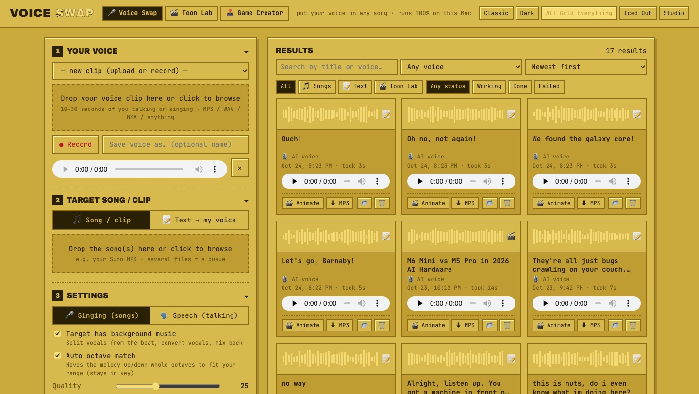
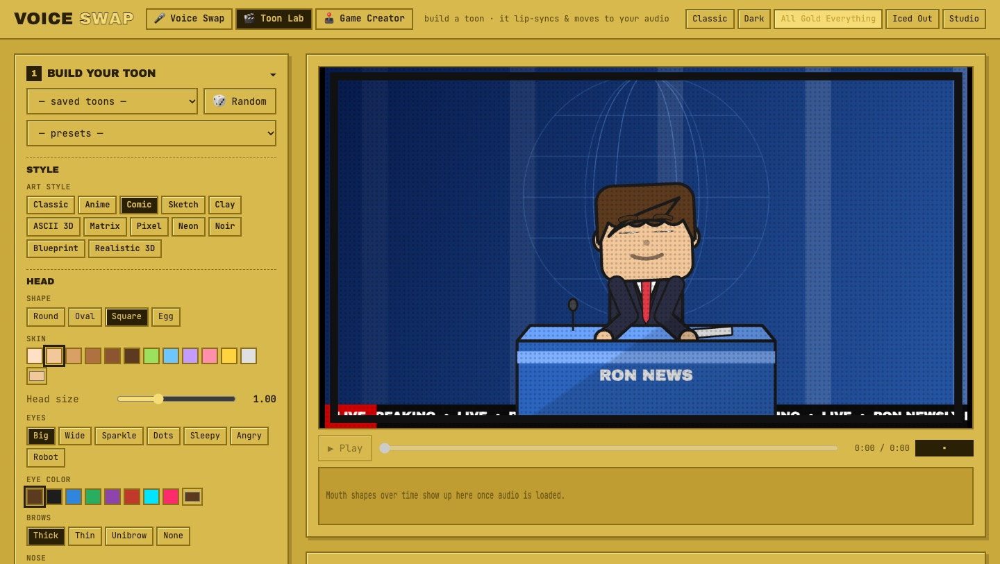
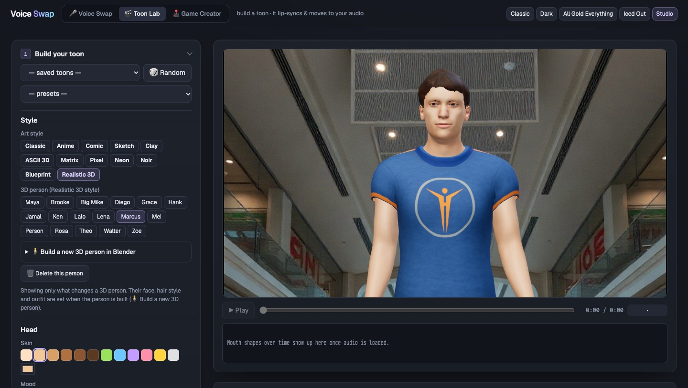
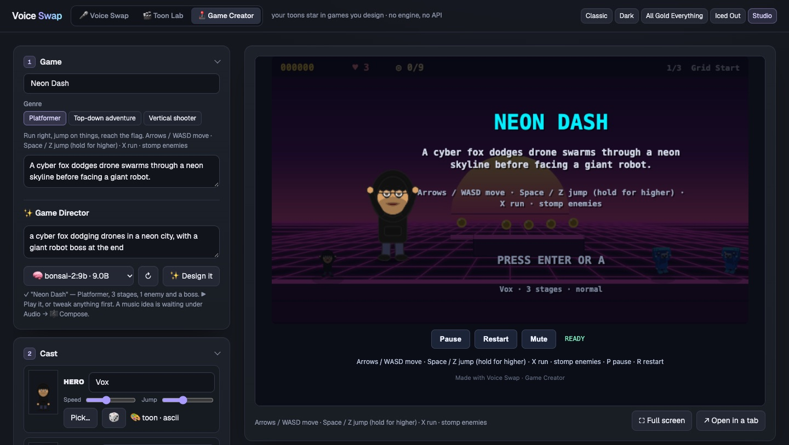
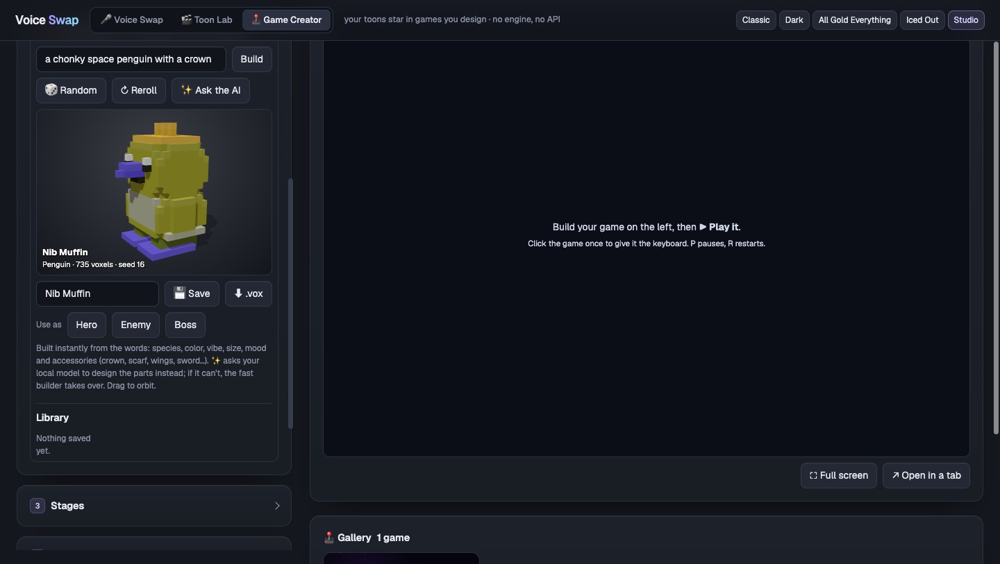
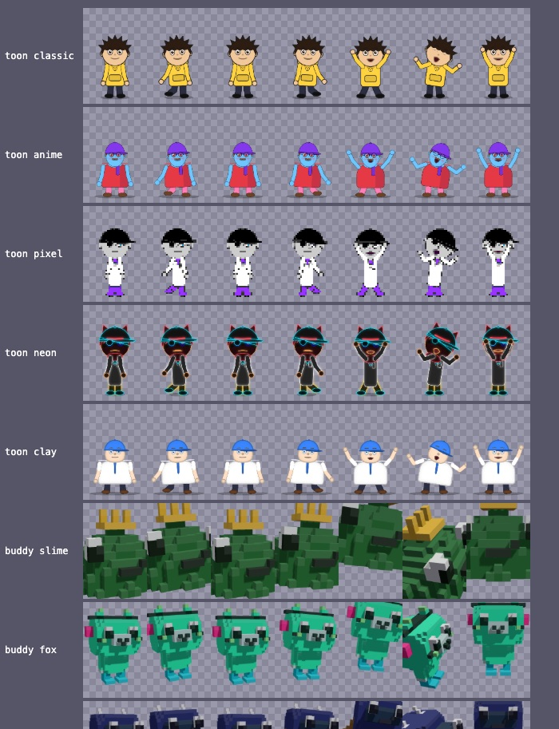

# Toon House

Three rooms, one local app: **Voice Swap** puts your own voice on any song, **Toon Lab** makes cartoons and 3D people that lip-sync in it, and the **Game Creator** turns them into playable games. Free, offline, no training, no API keys.

Put **your own voice** on any song — locally, free, no training.

Give it 10–30 seconds of you talking (or singing) and a target track (e.g. a Suno MP3). It splits the vocals from the beat, re-sings the vocals in your voice, and mixes them back into a new MP3.

Everything is one file: **`index.php`**. The first time you open it, it installs its own engine next to itself.



| Piece | What it does |
|---|---|
| [Demucs](https://github.com/facebookresearch/demucs) (htdemucs) | Splits the song into vocals + instrumental |
| [Seed-VC](https://github.com/Plachtaa/seed-vc) (44 kHz singing model) | Zero-shot voice conversion — your timbre, the original melody & lyrics |
| [Kokoro](https://huggingface.co/hexgrad/Kokoro-82M) (82M TTS) | Reads text out loud, so you can type what your voice says |
| ffmpeg | Decoding, cleanup, final mix → 320 kbps MP3 |

## Requirements

- Mac with Apple Silicon (M1/M2/M3/M4). **16 GB+ RAM recommended, 32 GB ideal.** 8 GB works for short clips with everything else closed.
  Linux works too (CPU or NVIDIA).
- ~6 GB free disk (Python packages + ~2 GB of models)
- Homebrew packages:

```bash
brew install php ffmpeg python@3.11 git
```

## Install & run

One line does it all (installs the tools above, clones the app, installs the engine, offers Ollama):

```bash
curl -fsSL https://raw.githubusercontent.com/lalomorales22/toon-house/main/install.sh | bash
```

It asks before anything big, never uses sudo on macOS, and ends by starting the app. Flags: `--yes` (no questions), `--no-engine` (skip the ~3 GB engine download), `--ollama` (also set up a local model), `--dir <path>`. Already cloned? `./install.sh` works from inside the folder too.

By hand:

```bash
git clone https://github.com/lalomorales22/toon-house.git
cd toon-house
php index.php
```

That starts a local server at **http://127.0.0.1:8777** and opens your browser. Click **Install engine** (one time, ~10 min: downloads PyTorch, Seed-VC, Demucs and the models into `engine/`).

Prefer the terminal for the install? `php index.php setup`

> Always start it with `php index.php` (not `php -S …` by hand) — the launcher raises PHP's upload limit to 1 GB so full songs upload.

## Use it

1. **Your voice** — drop a clip, hit **● Record** (up to 40 s), or pick a saved voice. Type a name in *Save voice as…* to reuse it later.
2. **Target song** — drop one or more MP3/WAV/M4A/FLAC/MP4 files. Several files = a queue.
   Or switch to **📝 Text → my voice**: type, paste, or drop a `.txt` / `.md` file. An AI reader (pick one close to your accent and pace) speaks it, then it's converted into your voice. Markdown headings, bullets and links are cleaned up first.
3. **Settings**
   - **Singing / Speech** — Singing for songs (keeps the melody). Speech for spoken clips.
   - **Target has background music** — on for songs, off for a dry acapella or voice clip.
   - **Auto octave match** — if the original singer is in a different range than you, it moves the melody whole octaves only, so you stay in key with the beat.
   - **Quality** — diffusion steps. 25 is a good default; 40–50 for final renders.
   - **Pitch** — manual semitone shift on top of auto.
   - *Advanced*: clean my voice clip, voice likeness, vocal/music volume, and *Original vox* (blend some of the original singer back in — helps harmonies/ad-libs).
4. **Generate.** When it's done you get:
   - **Song with my voice** (the full mix)
   - **My vocals only**
   - **Instrumental**

Every result lands in the **Results** gallery: search by title or voice, filter by kind (songs, speech, text, Toon Lab) and status, and sort. Files are saved in `jobs/<id>/`; 📂 opens the folder in Finder.

The steps fold up (click a heading) and stay the way you left them. Pick a look in the top right: Classic, Dark, All Gold Everything, Iced Out or **Studio** (graphite and lavender, for long sessions).

## Toon Lab — make a cartoon lip-sync to audio



Click **🎬 Toon Lab** in the header (or **🎬 Animate** on any finished Voice Swap result).

1. **Build your toon**:
   - **Art style**: Classic, Anime, Comic, Sketch, Clay, ASCII 3D, Matrix, Pixel, Neon, Noir, Blueprint or **Realistic 3D**. 🎲 rolls the style too.
   - **Realistic 3D** swaps the cartoon for a rigged 3D person rendered with [Three.js](https://threejs.org): real skin and hair, soft shadows, lip-sync from the same mouth shapes (Oculus visemes), blinking, eye darts, head nods and hand gestures. Pick the **3D person**. Hair, clothes and skin colors, glasses/shades, background, camera, subtitles and captions all still apply; props, hats and the cartoon face options don't.
     
     - Two ready-made people download on first use (~40 MB): Maya (MakeHuman, CC0) and Brooke (Ready Player Me, CC BY-NC: personal use).
     - **🧍 Build a new 3D person in Blender**: body, age, build (slim, average, athletic, heavy), height, ethnicity (face shape), skin tone (light to dark), hair and hair color, brows, eye color, outfit and shoes. It runs Blender in the background with the free [MPFB](https://static.makehumancommunity.org/mpfb.html) (MakeHuman) extension and the [TalkingHead](https://github.com/met4citizen/TalkingHead) rig and face shapes, and takes about 10 seconds. The first build installs MPFB into Blender and downloads ~280 MB of CC0 skins, hair and clothes. Presets are played by Marcus, Walter, Theo, Ken and Rosa when those exist.
     - Any GLB with a Mixamo-style skeleton and ARKit + Oculus viseme blend shapes works: drop it in `avatars/`. An optional `avatars/<name>.json` sets `label`, `mouth` (lip-sync strength) and `tongue`.
   - **Look**: head, skin, eyes (including sparkle, angry and robot), brows, nose, ears, mood, 13 hair styles, hats (cap, beanie, hood up, top hat, cowboy, crown, wizard), face fuzz, build and outfit (tee, hoodie, jacket, suit, jersey, lab coat, overalls, robe, dress).
   - **Accessories**: glasses, shades, cyber visor, eye patch, chain, tie, bow tie, scarf, headphones and more.
   - **Something to hold or sit at**: mic, coffee, phone, guitar, gamepad, computer desk, laptop or news desk.
   - **Background**: stage, sky, studio, hacker den, city night, newsroom, matrix rain, space, synthwave, solid color, green screen, or **🖼 Picture**: a scene of your own.
     - Describe a scene and **🎨 Make it**. It's painted by [FLUX.1-schnell](https://huggingface.co/black-forest-labs/FLUX.1-schnell) through your Hugging Face login (`hf auth login`, the free monthly credits cover a few dozen pictures), in a look that matches the art style. *Free, no account* uses Pollinations instead (lower quality, small watermark).
     - **⬆ Upload** (or drop) any JPG / PNG / WebP, e.g. one made in ChatGPT. Pictures are kept in `scenes/` and the camera drifts slowly across them.

   Start from a **⭐ preset** (hacker, news anchor, rapper, anime, wizard, streamer, robot, cowboy, scientist), or 🎲 for a random toon. Name it and **Save** to reuse it. Saved toons can also star in the Game Creator.
   - **✨ AI Director** (step 2 → ✨ Director): describe a video in one sentence ("a hacker on a computer in 3D ASCII style talking about local AI news"). Your local AI model picks a preset, art style, captions and reader voice and writes the script. **📰 Find a news story on this** searches DuckDuckGo News for this week's stories on your topic. Pick one, and the script reports it from the article's own text, naming the source. It uses **Ollama** by default, and the dropdown lists every text model you've pulled. Under ⚙ Model server you can point it at any OpenAI-compatible server instead (llama.cpp, LM Studio, MLX…).
2. **Audio**:
   - **🎵 Audio**: drop a voice clip or song, pick a Voice Swap result, or hit **🎙 Live mic** to puppet the toon in real time.
   - **📝 Type it**: type a script, or load a `.txt` / `.md` file, and hit **🗣 Speak it**. It's read in your saved voice, or the AI voice only, which is faster. The mouth then syncs automatically, and subtitles use your exact words.
   - **⚡ Instant** runs as soon as the audio loads: it reads the vowel (ooo / ahh / eee…) from the sound's formants, right in the browser.
   - **🔬 Precise** (*Sync the mouth*) runs a phoneme recognizer ([wav2vec2 espeak](https://huggingface.co/facebook/wav2vec2-lv-60-espeak-cv-ft), ~1.2 GB, downloaded on first use) to find each speech sound, and Whisper for the words. Tick *Has background music* to isolate the voice with Demucs first. Voice Swap results use their clean vocals automatically.
   - **🎵 Background music**: pick a track, set its volume, and it loops under the voice, dipping while the toon talks, and fades out at the end. It's mixed into the recorded video. **🎼 Compose** writes a new track from a description with [MusicGen small](https://huggingface.co/facebook/musicgen-small) on this Mac (about a minute for 20 s; the first use downloads 2.4 GB; the model's license is non-commercial). Or upload your own MP3 / WAV. Tracks are kept in `music/`.
3. **Motion**:
   - **🎥 Move with my camera**: click 📷 Start camera and the character mirrors you live. [MediaPipe](https://ai.google.dev/edge/mediapipe) tracks your head (turn, nod, tilt), eyes and winks, brows, mouth, shoulders, both arms down to the hands, side-to-side steps, and your legs when they're in view. Realistic 3D people copy all 52 of your face shapes. Choose what it follows (face, arms, body), whether the mouth copies yours or lip-syncs to the audio, and how much smoothing. It all runs in the browser, and no video leaves the Mac.
     - **● Record video** with the camera on records you acting it out: over the loaded clip, with 🎙 Live mic, or silently.
     - **● Record my moves** captures just the performance (acting along to the clip if one is loaded). With the camera off, your moves then play back on any audio, e.g. a script you type and 🗣 Speak it. Takes last until you reload the page.
   - **Automatic motion**: mouth size, body energy, hand gestures, sync offset, *Dance to the beat*, and the **camera** framing (full body, medium, close-up).
4. **Subtitles & captions** (burned into the video):
   - *Subtitles* come from the Whisper words: Karaoke (word highlight), Classic subtitle, or Pop words, in 12 fonts, with size, colors, position and an optional dark box. Fix misheard lines under *Fix the subtitle text*, and download them as an `.srt` for YouTube.
   - *Captions* are your own text: titles, lower-thirds and speech bubbles, each with its own font, color, size and start/end time.
5. **Make the video** (bottom of the sidebar): pick the frame (16:9, 9:16, 1:1) and **● Record video**. It plays the clip, records the stage + audio and saves an MP4 in `renders/`.
   Every MP4 lands in the **🎞 Gallery** under the stage: search it, filter by frame and style, sort it, and click a video to play, download, show in Finder or delete it.
   Or **🚀 Make it in the background**: it speaks the script, syncs the mouth and records in a hidden Chrome window while you keep working. This needs Google Chrome, Chromium, Brave or Edge.

## Game Creator — your toons star in games you design



Click **🕹 Game Creator** in the header. Games run on a small engine built into the app: no game framework, no API, nothing to install. Every game is **one HTML file** with its sprites, backdrops, music and voice lines embedded, so it plays anywhere, offline.

1. **Game**: a name, a genre, a line for the title screen.
   - **Platformer**: run right, jump on things (hold for higher), stomp enemies, springs, keys and locked doors, reach the flag.
   - **Top-down adventure**: rooms and corridors, 8-way movement, a sword swing (Space), a dash (X), key and door, an exit.
   - **Vertical shooter**: fly up, hold Space to fire, X drops a bomb; waves of enemies, asteroids, mines and a boss.
   - **✨ Game Director**: describe the game in a sentence and your local model (Ollama) picks the genre, invents the cast as voxel buddies, lays out the stages and writes the voice lines. Then change anything.
2. **Cast**: a hero, up to three enemies (each patrols, chases, flies or shoots) and an optional boss. Pick any toon saved in Toon Lab or a preset (they keep their art style in the game: anime, pixel, neon, clay…), a random toon, or a **voxel buddy**. Every character is rendered into a 7-frame sprite sheet: idle, walk, jump, hurt, win.
   - **🧱 Voxel buddies**: type a sentence ("a chonky space penguin with a crown") and a chunky 3D character is built instantly from the words: species, color, vibe, size, mood and accessories.

     
 ↻ Reroll for another take, **✨ Ask the AI** to have your local model design the parts, 💾 Save to the library, ⬇ export a `.vox` for MagicaVoxel, Goxel or Blender. Adapted from [voxel-buddies](https://github.com/lalomorales22/voxel-buddies), with Ollama instead of a paid API.
3. **Stages**: up to 8. Each has a backdrop (any Toon Lab background, or a scene picture), a length, a challenge level, an optional key and door, an optional boss, and its own music track. **🎲 New layout** generates the level from a seed; then **paint** it: ground, platforms, coins, gems, spikes, springs, keys, doors, enemies, the boss, the start and the goal. Right-click erases.
4. **Rules & feel**: lives, difficulty, how a stage is cleared (reach the goal, collect every coin, beat the boss, survive the clock), a time limit, gravity, jump and speed, and the win / game-over lines.
5. **Audio**: sound effects are synthesized in the game (four styles: chip, arcade, soft, glitch; 🎲 gives any effect a different take). Music is any track in the `music/` library, and you can compose one with MusicGen right there. Voice lines are spoken in your saved voice (or the AI reader) at the start, on a win, on game over and when hurt.
6. **Play & save**: **▶ Play it** runs the game in the page (keyboard and touch), **💾 Save** keeps it in the gallery, **⬇ Download** gives you the HTML file. Any saved game can be played, remixed or downloaded from the gallery.

In a game: arrows / WASD move, Space or Z is the action, X the second action, Enter starts, P pauses, R restarts. Progress is checkpointed at each stage in the browser.



The cartridge format and the cast / stages / rules model follow the Game-Maker app; the engine, level generators, sprite pipeline and sound synth are built into `index.php`.

## Agents & the command line

Another agent (or you, from a terminal) can make the whole video from one JSON **spec**: character, art style, script, voice, captions, subtitles, camera and frame.

```bash
php index.php options                  # every option, preset, saved voice, reader voice and font (JSON)
php index.php make spec.json --wait    # script → your voice → lip-sync → MP4; prints render_path
php index.php make --prompt "a robot explaining black holes" --wait   # let the local Director write the spec
php index.php person person.json       # build a realistic 3D person in Blender (needs Blender; see options → person_builder)
php index.php skill                    # link the Claude Code skill into ~/.claude/skills
```

The skill lives in [`skills/toon-studio/SKILL.md`](skills/toon-studio/SKILL.md). It documents the spec, the recipes and an HTTP API (`POST ?a=make` with a JSON body, then `GET ?a=make_status&id=…`). Copy that folder to give any agent the same powers.

The mouth has 12 shapes (rest, m/b/p, f/v, th, l, s/t/k, sh/ch, r, eee, eh, ahh, oh, ooo); the jaw opens wider on louder audio. The body breathes and blinks, nods on stressed syllables, and gestures with its hands.

## Tips for good results

- Record your clip in a quiet room, close to the mic, no music behind you. Talking naturally is fine; singing a bit is even better.
- 10–20 seconds of clean voice is better than 30 seconds of noisy voice.
- If it sounds too much like the original singer, raise **Voice likeness**. If it gets garbly, lower it or raise **Quality**.
- Heavy reverb, stacked harmonies and screaming in the source song are hard for any voice converter — use *Original vox* at 10–20% to keep them.

## Speed

Rough numbers per minute of song:

| Machine | Time |
|---|---|
| M1, 8 GB (measured, with other apps open) | ~7 min — auto-uses a 15 s window + 6 s voice reference |
| M-series, 32 GB | faster, and uses the full 30 s window + 15 s reference for better likeness |
| NVIDIA GPU (Linux) | about real time |

The worker picks the window size from your RAM automatically (≤8 GB / ≤16 GB / more).

Only one job runs at a time; the rest wait in the queue.

## How it works / files

```
index.php          ← the whole app (UI + API + embedded worker & installer)
engine/            ← created on install: venv, Seed-VC checkout, models, worker.py
jobs/              ← one folder per conversion (inputs, status, MP3 outputs)
voices/            ← your saved voice clips
characters/        ← your saved toons
toons/             ← Toon Lab analyses (auto-cleaned after 3 days)
renders/           ← Toon Lab MP4s
projects/          ← specs + status for background / agent renders
avatars/           ← 3D people (.glb + .json) for the Realistic 3D style
scenes/            ← background pictures (uploaded or generated)
music/             ← background music tracks (uploaded or composed)
games/             ← saved games: game.json (the design), index.html (the playable file), thumb.jpg
buddies/           ← saved voxel buddies (recipe + thumbnail)
vendor/three/      ← Three.js 0.170 (MIT), so the 3D style works offline
vendor/mediapipe/  ← MediaPipe Tasks Vision 0.10.35 + face/pose models (Apache-2.0), for camera motion capture offline
skills/            ← the toon-studio agent skill
settings.json      ← the Director's AI model address
```

`index.php` writes `engine/worker.py`, `engine/install.sh`, `engine/gen.py` (scenes, music, news) and `engine/person.py` (the Blender script) from copies embedded in itself, so updating the app is just replacing `index.php`.

Apple-Silicon fixes applied by the worker (Seed-VC upstream is unchanged):
- the pitch tracker (RMVPE) runs in 20 s chunks and returns float32 (MPS has no float64)
- the BigVGAN vocoder runs in short overlapping windows (MPS has a 65 536-sample conv limit)
- the diffusion context window shrinks on low-RAM Macs

## Responsible use

Only clone voices you own or have permission to use. Don't use this to impersonate real people.

## License

MIT for this app. Seed-VC (GPL-3.0) and Demucs (MIT) are downloaded at install time under their own licenses.
